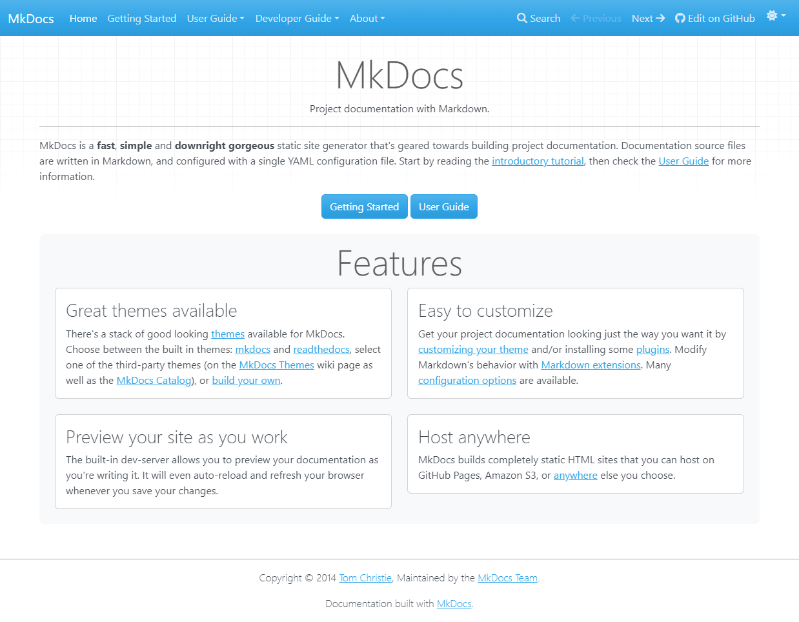
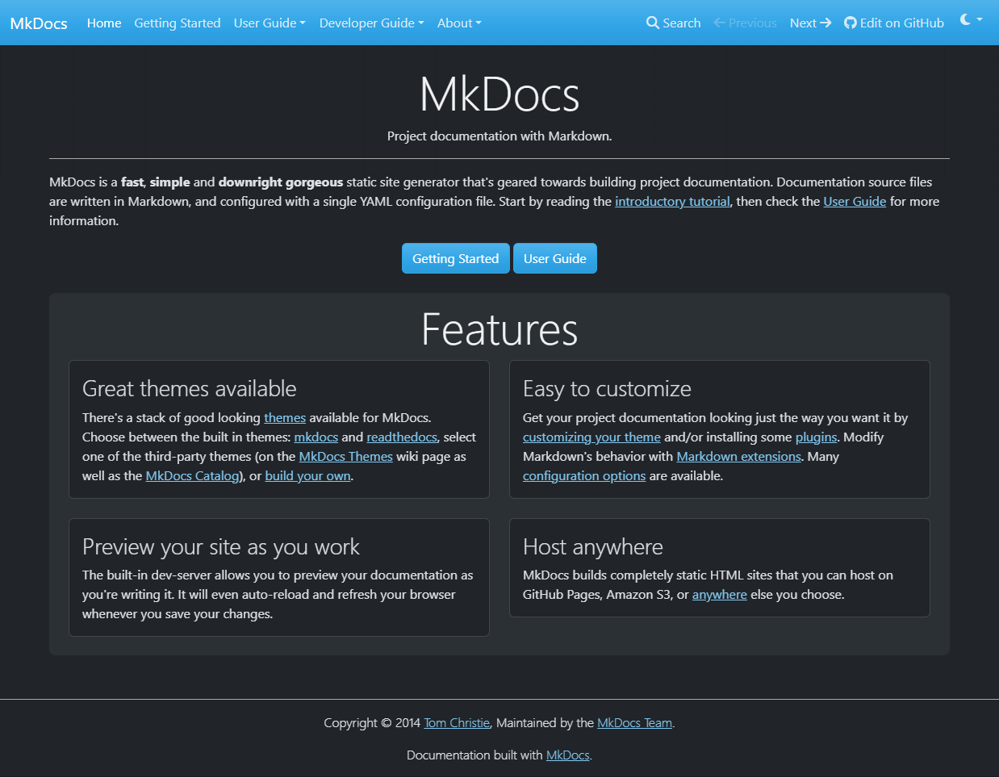

<div style="display: none;"><h1>ProperDocs-Part2-Build-and-Fixes</h1></div>

{: style="display: block; margin: 0 auto"}

## ProperDocs - Part 2, Build and Fixes. { .centered }

### Adding ProperDocs to the Afridyne Systems site. { .centered }

!!! pied-piper "Adding ProperDocs to the Afridyne Systems site"
    [Part 1](ProperDocs-Part1-Setup.md) ended with the files copied and the nav entry added. This part covers the first build and clearing every message, the visual checks, the deploy routine, and some fixes found later.
    
## 1. The first build

!!! desc "1. The first build"

    ```bash
    cd /home/johnpc/AfridyneSystems
    mkdocs serve --clean
    ```
    
    It started fine, with these messages. Each one was cleared, in this order.
    
    | Message | Cause | Fix |
    |---|---|---|
    | 11 INFO lines about unrecognized relative links in `properdocs/index.md` | links written in directory style, such as `getting-started/` | section 1.1 |
    | WARNING: `img/favicon.ico` not found in `getting-started.md` | the file isn't in the docs folder | section 1.2 |
    | WARNING: autorefs found multiple primary URLs for `mkdocs` | your `about.md` and ProperDocs' `choosing-your-theme.md` both have a heading with the id `mkdocs` | section 1.3 |
    | INFO: signature formatting needs Black or Ruff | new with the Python API pages | section 1.4 |
    
### 1.1 Relative links on the ProperDocs home page

!!! recommendation "1.1 Relative links on the ProperDocs home page"

    Only lines 16, 22, 26 and 34 use the directory-style links. Back up the file, fix them and check the diff:
    
    ```bash
    cd /home/johnpc/AfridyneSystems/docs/properdocs
    cp index.md /tmp/properdocs-index.md.bak
    sed -i \
      -e 's|(getting-started/)|(getting-started.md)|g' \
      -e 's|(user-guide/)|(user-guide/README.md)|g' \
      -e 's|(user-guide/choosing-your-theme/#|(user-guide/choosing-your-theme.md#|g' \
      -e 's|(user-guide/choosing-your-theme)|(user-guide/choosing-your-theme.md)|g' \
      -e 's|(dev-guide/themes/)|(dev-guide/themes.md)|g' \
      -e 's|(user-guide/customizing-your-theme/)|(user-guide/customizing-your-theme.md)|g' \
      -e 's|(user-guide/configuration/#|(user-guide/configuration.md#|g' \
      -e 's|(user-guide/configuration/)|(user-guide/configuration.md)|g' \
      -e 's|(user-guide/deploying-your-docs/)|(user-guide/deploying-your-docs.md)|g' \
      index.md
    diff /tmp/properdocs-index.md.bak index.md
    ```
    
### 1.2 The favicon reference

!!! ex "1.2 The favicon reference"

    `getting-started.md` line 138 is a link definition, `[ProperDocs favicon]: img/favicon.ico`. Point it at your own favicon, which sits at `docs/assets/favicon.png`. From inside `docs/properdocs/` that path is `../assets/favicon.png`:
    
    ```bash
    cd /home/johnpc/AfridyneSystems/docs
    ls assets/favicon.png
    cp properdocs/getting-started.md /tmp/properdocs-getting-started.md.bak
    sed -i '138s|img/favicon.ico|../assets/favicon.png|' properdocs/getting-started.md
    diff /tmp/properdocs-getting-started.md.bak properdocs/getting-started.md
    ```
    
### 1.3 The duplicate `mkdocs` heading id

!!! desc "1.3 The duplicate `mkdocs` heading id"

    Your own `about.md` has `## MkDocs`, and ProperDocs' `choosing-your-theme.md` has `## mkdocs`. Both get the id `mkdocs`, which confuses the `[MkDocs][mkdocs]` references in your other pages. Leave yours alone and give the ProperDocs heading a different id, `theme-mkdocs`, then update every link aimed at it.
    
    First find out what points at it:
    
    ```bash
    cd /home/johnpc/AfridyneSystems/docs
    grep -nE '^#+ ' properdocs/user-guide/choosing-your-theme.md
    grep -rn '#mkdocs' properdocs --include='*.md'
    ```
    
    ---
    
    Six lines need changing: the heading (line 17) and a link to it (line 7) in `choosing-your-theme.md`, two links in `release-notes.md`, one in `customizing-your-theme.md` and one in `index.md`. The line numbers are specific to this version of the file, so check them with the `grep` first. `#mkdocs-locale` is a separate anchor and stays as it is.
    
    ```bash
    cd /home/johnpc/AfridyneSystems/docs
    cp -r properdocs /tmp/properdocs-pre-autorefs
    
    sed -i -e '17s|^## mkdocs[[:space:]]*$|## mkdocs { #theme-mkdocs }|' \
           -e '7s|(#mkdocs)|(#theme-mkdocs)|' \
      properdocs/user-guide/choosing-your-theme.md
    
    sed -i -E 's,(choosing-your-theme\.md)#mkdocs([^-]|$),\1#theme-mkdocs\2,g' \
      properdocs/about/release-notes.md \
      properdocs/user-guide/customizing-your-theme.md \
      properdocs/index.md
    
    diff -r /tmp/properdocs-pre-autorefs properdocs
    echo "== remaining #mkdocs links =="; grep -rn '#mkdocs' properdocs --include='*.md'
    ```
    
    ---
    
    The diff should show exactly those six lines. The remaining `#mkdocs` hits should only be `#mkdocs-locale` links and the external readthedocs URL in `themes.md`.
    
    **Tip:** the first attempt at the second `sed` used `|` as the delimiter and also as "or" inside the pattern, so it matched nothing. Using `,` as the delimiter with `-E` avoids that.
    
### 1.4 The signature formatter

!!! tldr "1.4 The signature formatter"

    Install Ruff in the venv and add it to `requirements.txt`, so CI behaves the same. Then **stop and restart** the server, because the handler only checks for Ruff at startup:
    
    ```bash
    uv pip install --python /home/johnpc/.venv/bin/python ruff
    printf 'ruff\n' >> /home/johnpc/AfridyneSystems/requirements.txt
    tail -4 /home/johnpc/AfridyneSystems/requirements.txt
    cd /home/johnpc/AfridyneSystems
    mkdocs serve --clean
    ```
    
    After this the build was clean, with only the usual markmap INFO lines.
    
## 2. Visual checks

!!! desc "2. Visual checks"

    A clean build only proves nothing errored, so open the pages and look. Start at `http://127.0.0.1:8000/Afridyne-Systems/` and go to **Home**, then **ProperDocs**.
        
    | Page | What to look for |
    |---|---|
    | Developer Guide, API Reference | class and method documentation filled in, not raw `::: properdocs...` lines |
    | User Guide, Command Line Interface | the `properdocs` command with option tables and five subcommands (build, get-deps, gh-deploy, new, serve) |
    | Developer Guide, Plugins | the plugin events diagram partway down, with clickable event titles |
    | ProperDocs Home | "Getting Started" and "User Guide" land on the right pages, and the `mkdocs` theme link ends in `#theme-mkdocs` |
    | Sidebar | the Developer Guide and User Guide section names open their overview pages |
    
    **Note:** the CLI table's `-h, --help` row shows `Sentinel.UNSET` in the default column. That's a cosmetic quirk of `mkdocs-click`, harmless.
    
## 3. The deploy routine

!!! ex "3. The deploy routine"

    First look at what a deploy would send. This is the same `rsync` as the Deploy script with `-n` added, so nothing is written:
    
    ```bash
    rsync -avn --delete --exclude='.git' --exclude='.cache' --exclude='/README.md' \
      /home/johnpc/AfridyneSystems/ /mnt/sdb/AfridyneSystems/
    ```
    
    For the first ProperDocs deploy the list is the 31 files under `docs/properdocs/`, plus `mkdocs.yml` and `requirements.txt`. Look out for:
    
    - any line starting with `deleting`, which would be a file removed from the Git site
    - anything that shouldn't be there, such as a `.bak` file or a temporary yaml
    - files that differ because of earlier unfinished edits, which will go live with this deploy
    
    Then the usual routine:
    
    1. Stop the server (Ctrl+C).
    2. Run `mkdocs serve --clean` for a clean build and check the terminal for `WARNING` or `ERROR` lines.
    3. Stop the server and run Deploy. The script asks for a commit message.
    4. Watch the **Actions** tab on the repo for the green tick. The page sometimes looks stuck while the run has actually finished. Go to the repo's main page and click back to Actions.
    5. Open the live ProperDocs pages and check them.
    
## 4. Fixes found later

### 4.1 API pages showed source code and lacked headings

!!! desc "4.1 API pages showed source code and lacked headings"

    After the first deploy the API pages showed "Source code in" blocks, with the docstring cross-reference syntax visible, and entries such as `homepage` and `pages` on the themes page had no heading above them. The cause was a bare `- mkdocstrings` plugin line. ProperDocs' own `properdocs.yml` sets options globally and its pages rely on them:
    
    - `show_source: false` hides the "Source code in" blocks
    - `show_root_heading: true` gives entries like `homepage` their headings
    - `members_order: source`, `docstring_section_style: list` and `show_signature_annotations: true` control order and layout
    
    These options apply to every live `:::` directive on the site, so first check the other pages. This reports whether each `:::` line is inside a code fence (an example) or live:
    
    ```bash
    cd /home/johnpc/AfridyneSystems/docs
    grep -rln '^\s*:::' . --include='*.md' | grep -v '^./properdocs/'
    /home/johnpc/.venv/bin/python - <<'EOF'
    import re
    for f in ['Mkdocstrings/usage.md', 'Mkdocstrings/handlers.md', 'MkDocstrings.md']:
        infence = False
        for n, line in enumerate(open(f, encoding='utf-8'), 1):
            if re.match(r'\s*(```|~~~)', line):
                infence = not infence
                continue
            if re.match(r'\s*:::', line):
                print(f, n, 'INSIDE FENCE' if infence else 'LIVE', line.strip()[:80])
    EOF
    ```
    
    ---
    
    Here every one was inside a code fence, so the change only affected ProperDocs. Replace the bare `  - mkdocstrings` line in the `plugins:` section of `mkdocs.yml` with this block (back up the yaml first, as in Part 1):
    
    ```yaml
      - mkdocstrings:
          handlers:
            python:
              options:
                docstring_section_style: list
                members_order: source
                show_root_heading: true
                show_source: false
                show_signature_annotations: true
    ```
    
### 4.2 `Highlight.__init__() missing 1 required positional argument: 'md'`

!!! ex "4.2 `Highlight.__init__() missing 1 required positional argument: 'md'`"

    This appeared after upgrading `mkdocs-materialx` locally, on the first build, on `api.md`. It was a version clash and not a problem in the site. `pymdown-extensions` 12.2 made `md` a required argument, and the installed `mkdocstrings` 1.0.0 didn't pass it. `mkdocstrings` 1.0.7 does, so the fix was to upgrade it:
    
    ```bash
    uv pip install --python /home/johnpc/.venv/bin/python --upgrade mkdocstrings
    uv pip list --python /home/johnpc/.venv/bin/python | grep -iE '^(mkdocstrings|pymdown-ext|griffe)'
    ```
    `uv pip install --upgrade mkdocs-materialx` only upgrades MaterialX and its own dependencies. Extras such as `mkdocstrings` stay where they are, so upgrade them in the same command and run `mkdocs serve --clean` straight afterwards. CI was unaffected, because it installs the current versions of everything unpinned.
    
    **Habit:** before any update, save the exact package versions so you can roll back:
    
    ```bash
    uv pip freeze --python /home/johnpc/.venv/bin/python > /home/johnpc/cardwork/venv-before-update.txt
    ```
    
### 4.3 The Bootstrap carousel

!!! desc "4.3 The Bootstrap carousel"

    On the "mkdocs" theme section of `choosing-your-theme.md` the light and dark screenshots were wrapped in Bootstrap carousel HTML. That only works with ProperDocs' own theme, which loads Bootstrap. On MaterialX it never slid and showed only the first image. Content tabs do the same job in Markdown. Inside the admonition (note the indentation, 4 for the admonition and 4 more for the tab):
        
    ```text
        === "Light mode"
    
            
    
        === "Dark mode"
    
            
    ```
    
    ---
    
    
    === "Light mode"
    
        
    
    === "Dark mode"
    
        
    
    
    Markdown image paths resolve from the page's own folder (`../img/`). The HTML version needed `../../img/` because raw HTML resolves from the page's URL.
    
### 4.4 Checking for other raw HTML

!!! ex "4.4 Checking for other raw HTML"

    
    ```bash
    grep -rn 'carousel' /home/johnpc/AfridyneSystems/docs/properdocs --include='*.md'
    grep -rnE '` in `user-guide/README.md`, the standard grid cards syntax
    - the events diagram in `plugins.md`, which needs HTML
    - search form and sidebar examples in `themes.md`, which sit inside fenced code blocks and are only text
    
### 4.5 Text that must be visible but kept out of the contents list

!!! desc "4.5 Text that must be visible but kept out of the contents list"

    A `######` heading always appears in the right-hand contents list, and the `.toc-hidden-header` class hides the text itself (it clips the element to 1 pixel), so it can't help. The fix on `about who-we-are.md` was to use a bold paragraph, with the attribute list on the line below:
    
    ```text
    **ProperDocs is a group of people who have the goal of maintaining the Legacy of the original MkDocs project.**
    {: .centered }
    ```
    
    A paragraph isn't a heading, so it stays out of the contents list. It's visible, centred and bold.
    
    [**Next:**](ProperDocs-Part3-Social-Cards-and-Banners.md) Part 3 covers the green social cards and the banner on every page.
    
