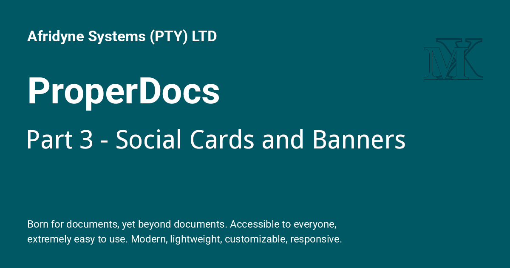
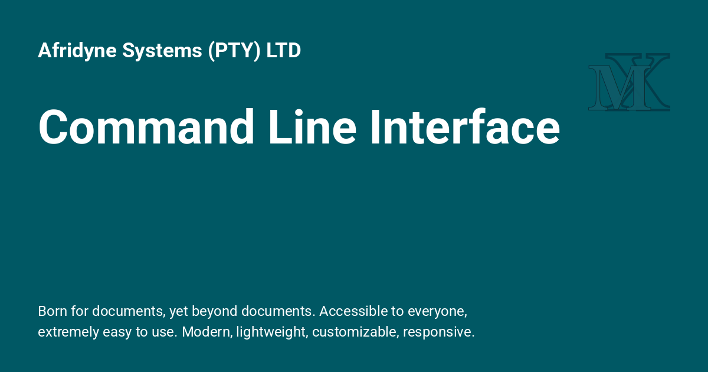
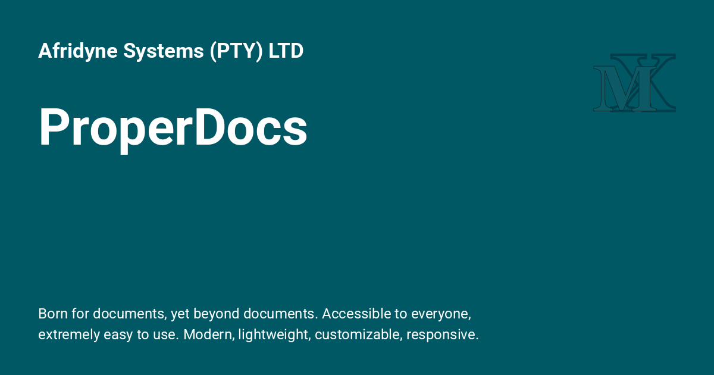

<div style="display: none;"><h1>ProperDocs-Part3-Social-Cards-and-Banners</h1></div>

{: style="display: block; margin: 0 auto"}

## ProperDocs - Part 3 - Social Cards and Banners. { .centered }

### Adding ProperDocs to the Afridyne Systems site. { .centered }

---

[Back to: Part 1  :fontawesome-solid-paper-plane:](ProperDocs-Part1-Setup.md){ .md-button .md-button--custom }

---

!!! desc "Banner Cards"

    The ZSH Guide pages each have a banner card at the top, a 1200 x 630 image with the site name, the page title in large white type and the MX logo. The goal here was the same layout for the 20 ProperDocs pages, but on a green background (`#005864`) instead of the blue (`#00a2e3`) of the ZSH cards.
    
    **Method:** instead of recolouring a finished card (which leaves ragged edges around the text), each card is rebuilt with Pillow. The layout is measured from an existing card, the text is redrawn in Roboto and the logo is cut out of the card and darkened to suit the green. Everything is made in a scratch folder **outside** the site, so nothing can be deployed by accident.
    
## 1. What was there

!!! recommendation "1. What was there"

    - The ZSH cards are in `docs/imgs/` (`index.png`, `01-introduction.png` and so on), at `#00a2e3`.
    - The Gimp template for the blue design is `docs/imgs/MaterialX_Master_Template.xcf`.
    - The `social` plugin has Roboto in its cache at `/home/johnpc/AfridyneSystems/.cache/plugin/social/fonts/Roboto/` (use `Bold.ttf` and `Regular.ttf`).
    - Pillow is already in the venv.
    
    Set up the scratch folder and copy one blue card into it:
    
    ```bash
    mkdir -p /home/johnpc/cardwork
    cp /home/johnpc/AfridyneSystems/docs/imgs/01-introduction.png /home/johnpc/cardwork/zsh-01.png
    find /home/johnpc/AfridyneSystems/.cache -iname '*.ttf' | head -20
    ```
    
## 2. Measure the card

!!! recommendation "2. Measure the card"

    This prints where the text and the logo sit, in pixels:
    
    ```bash
    /home/johnpc/.venv/bin/python - <<'EOF'
    from PIL import Image
    im = Image.open('/home/johnpc/cardwork/zsh-01.png').convert('RGB')
    W, H = im.size
    bg = im.getpixel((600, 400))
    def bands(x0, x1):
        out, band = [], None
        for y in range(8, H - 8):
            xs = [x for x in range(max(x0, 8), min(x1, W - 8)) if im.getpixel((x, y)) != bg]
            if xs and band is None:
                band = [y, y, min(xs), max(xs)]
            elif xs:
                band[1] = y; band[2] = min(band[2], min(xs)); band[3] = max(band[3], max(xs))
            elif band:
                out.append(band); band = None
        return out
    print("size", W, H, "bg", bg)
    print("left text (y0, y1, x0, x1):")
    for b in bands(0, 950): print("  ", b)
    print("logo area (y0, y1, x0, x1):")
    for b in bands(950, W): print("  ", b)
    EOF
    ```
    
    ---
    
    Results for the "1. Introduction" card:
    
    | Element | Box (x from-to, y from-to) |
    |---|---|
    | Site name | x 64 to 509, y 69 to 104 |
    | Title | x 69 to 637, y 176 to 242 |
    | Description, line 1 | x 65 to 790, y 517 to 539 |
    | Description, line 2 | x 65 to 803, y 552 to 574 |
    | MX logo | x 997 to 1135, y 90 to 188 |
    
## 3. Find the font sizes

!!! ex "3. Find the font sizes"

    This tries sizes until the drawn text matches the measured widths. It prints numbers only and writes nothing:
    
    ```bash
    /home/johnpc/.venv/bin/python - <<'EOF'
    from PIL import ImageFont
    F = '/home/johnpc/AfridyneSystems/.cache/plugin/social/fonts/Roboto/'
    targets = [
        ('site name',   'Bold.ttf',    'Afridyne Systems (PTY) LTD', 446),
        ('title',       'Bold.ttf',    '1. Introduction', 569),
        ('desc line 1', 'Regular.ttf', 'Born for documents, yet beyond documents. Accessible to everyone,', 726),
    ]
    for name, fn, text, w in targets:
        best = None
        for s in range(10, 200):
            f = ImageFont.truetype(F + fn, s)
            x0, y0, x1, y1 = f.getbbox(text)
            err = abs((x1 - x0) - w)
            if best is None or err < best[0]:
                best = (err, s, x0, y0, x1 - x0, y1 - y0)
        print(f"{name}: size {best[1]}, width {best[4]} (target {w}), offset x0,y0 = {best[2]},{best[3]}, height {best[5]}")
    EOF
    ```
    
    ---
    
    The best matches were **35** for the site name, **86** for the title and **24** for the description, all within a pixel or two of the original. Those are the sizes the generator below uses.
    
## 4. The titles and file names

!!! desc " 4. The titles and file names"

    The cards follow the `.md` file names as closely as possible, with a `properdocs-` prefix so they can't collide with your own pages:
        
    | Card title | Card file | Page |
    |---|---|---|
    | ProperDocs | `properdocs-index.png` | `index.md` |
    | Getting Started | `properdocs-getting-started.png` | `getting-started.md` |
    | User Guide | `properdocs-user-guide.png` | `user-guide/README.md` |
    | Installation | `properdocs-installation.png` | `user-guide/installation.md` |
    | Writing Your Docs | `properdocs-writing-your-docs.png` | `user-guide/writing-your-docs.md` |
    | Choosing Your Theme | `properdocs-choosing-your-theme.png` | `user-guide/choosing-your-theme.md` |
    | Customizing Your Theme | `properdocs-customizing-your-theme.png` | `user-guide/customizing-your-theme.md` |
    | Localizing Your Theme | `properdocs-localizing-your-theme.png` | `user-guide/localizing-your-theme.md` |
    | Configuration | `properdocs-configuration.png` | `user-guide/configuration.md` |
    | Command Line Interface | `properdocs-cli.png` | `user-guide/cli.md` |
    | Deploying Your Docs | `properdocs-deploying-your-docs.png` | `user-guide/deploying-your-docs.md` |
    | Developer Guide | `properdocs-dev-guide.png` | `dev-guide/README.md` |
    | Themes | `properdocs-themes.png` | `dev-guide/themes.md` |
    | Translations | `properdocs-translations.png` | `dev-guide/translations.md` |
    | Plugins | `properdocs-plugins.png` | `dev-guide/plugins.md` |
    | API Reference | `properdocs-api.png` | `dev-guide/api.md` |
    | Release Notes | `properdocs-release-notes.png` | `about/release-notes.md` |
    | Contributing | `properdocs-contributing.png` | `about/contributing.md` |
    | License | `properdocs-license.png` | `about/license.md` |
    | Who We Are | `properdocs-who-we-are.png` | `about/who-we-are.md` |
    
## 5. Generate all 20 cards

!!! decision "5. Generate all 20 cards"

    The script builds a blank green card from the blue one (keeping any border), cuts the MX logo out and scales its colour channels to suit the new green, draws the site name and description once, then draws each title. A title that would run into the logo is shrunk two points at a time until it fits (x of 950 or less). It also makes a contact sheet so you can see all 20 together.
    
    It only writes to `/home/johnpc/cardwork/`:
    
    ```bash
    /home/johnpc/.venv/bin/python - <<'EOF'
    import os
    from PIL import Image, ImageDraw, ImageFont
    
    F = '/home/johnpc/AfridyneSystems/.cache/plugin/social/fonts/Roboto/'
    SRC = '/home/johnpc/cardwork/zsh-01.png'
    OUTDIR = '/home/johnpc/cardwork/cards'
    OLD, NEW = (0, 162, 227), (0, 88, 100)          # blue #00a2e3 -> green #005864
    SITE = 'Afridyne Systems (PTY) LTD'
    DESC = ['Born for documents, yet beyond documents. Accessible to everyone,',
            'extremely easy to use. Modern, lightweight, customizable, responsive.']
    MAX_RIGHT = 950   # titles must end before the logo (starts at x=997)
    
    CARDS = [
        ('ProperDocs', 'properdocs-index'),
        ('Getting Started', 'properdocs-getting-started'),
        ('User Guide', 'properdocs-user-guide'),
        ('Installation', 'properdocs-installation'),
        ('Writing Your Docs', 'properdocs-writing-your-docs'),
        ('Choosing Your Theme', 'properdocs-choosing-your-theme'),
        ('Customizing Your Theme', 'properdocs-customizing-your-theme'),
        ('Localizing Your Theme', 'properdocs-localizing-your-theme'),
        ('Configuration', 'properdocs-configuration'),
        ('Command Line Interface', 'properdocs-cli'),
        ('Deploying Your Docs', 'properdocs-deploying-your-docs'),
        ('Developer Guide', 'properdocs-dev-guide'),
        ('Themes', 'properdocs-themes'),
        ('Translations', 'properdocs-translations'),
        ('Plugins', 'properdocs-plugins'),
        ('API Reference', 'properdocs-api'),
        ('Release Notes', 'properdocs-release-notes'),
        ('Contributing', 'properdocs-contributing'),
        ('License', 'properdocs-license'),
        ('Who We Are', 'properdocs-who-we-are'),
    ]
    
    os.makedirs(OUTDIR, exist_ok=True)
    src = Image.open(SRC).convert('RGB')
    W, H = src.size
    b = 0
    while src.getpixel((b, H // 2)) != OLD:
        b += 1
    
    # base card: green background, logo, site name, description
    base = src.copy()
    ImageDraw.Draw(base).rectangle([b, b, W - b - 1, H - b - 1], fill=NEW)
    logo = src.crop((997, 90, 1136, 189))
    ratio = (1.0, NEW[1] / OLD[1], NEW[2] / OLD[2])
    logo = Image.merge('RGB', [band.point(lambda v, r=r: min(255, round(v * r)))
                               for band, r in zip(logo.split(), ratio)])
    base.paste(logo, (997, 90))
    
    def place(img, text, fontfile, size, x0, y0):
        font = ImageFont.truetype(F + fontfile, size)
        mask = Image.new('L', (1100, 80), 0)
        ImageDraw.Draw(mask).text((20, 20), text, font=font, fill=255)
        ix, iy, _, _ = mask.getbbox()
        img.paste((255, 255, 255), (x0 - ix, y0 - iy), mask)
    
    place(base, SITE, 'Bold.ttf', 35, 64, 69)
    place(base, DESC[0], 'Regular.ttf', 24, 65, 517)
    place(base, DESC[1], 'Regular.ttf', 24, 65, 552)
    
    made = []
    for title, name in CARDS:
        size = 86
        while True:
            font = ImageFont.truetype(F + 'Bold.ttf', size)
            right = 64 + font.getbbox(title)[2]
            if right <= MAX_RIGHT:
                break
            size -= 2
        card = base.copy()
        ImageDraw.Draw(card).text((64, 243), title, font=font, fill=(255, 255, 255), anchor='ls')
        card.save(f'{OUTDIR}/{name}.png')
        made.append(f'{OUTDIR}/{name}.png')
        note = '' if size == 86 else f'  <-- shrunk from 86'
        print(f'{name}.png  size {size}  right edge {right}{note}')
    
    # contact sheet: 4 columns x 5 rows
    tw, th, gap = 300, 158, 10
    sheet = Image.new('RGB', (4 * tw + 5 * gap, 5 * th + 6 * gap), (30, 30, 30))
    for i, path in enumerate(made):
        thumb = Image.open(path).resize((tw, th), Image.LANCZOS)
        sheet.paste(thumb, (gap + (i % 4) * (tw + gap), gap + (i // 4) * (th + gap)))
    sheet.save('/home/johnpc/cardwork/contact-sheet.png')
    print(len(made), 'cards written to', OUTDIR)
    EOF
    ```
    
    ---
    
    Only two titles needed shrinking: "Customizing Your Theme" (86 down to 78) and "Command Line Interface" (86 down to 80). The difference is hardly noticeable. Open `/home/johnpc/cardwork/contact-sheet.png` and check all 20 before going on.
    
## 6. Copy the cards into the site

!!! ex "6. Copy the cards into the site"

    `cp -n` never overwrites an existing file. The first count should be 0 and the second 20:
    
    ```bash
    cd /home/johnpc/AfridyneSystems/docs
    find imgs -name 'properdocs-*' | wc -l
    cp -n /home/johnpc/cardwork/cards/properdocs-*.png imgs/
    find imgs -name 'properdocs-*.png' | wc -l
    ```
    
## 7. The banner block on each page

!!! desc "7. The banner block on each page"

    Every page gets the block already used on the Admonitions page: a hidden `<h1>` (for the page title in the browser tab and search), the card, then a visible centred heading:
    
    ```text
    <div style="display: none;"><h1>Command Line Interface</h1></div>
    
    {: style="display: block; margin: 0 auto"}
    
    <H1 style="text-align: center;"><ins>Command Line Interface</ins></H1>
    ```
    
    The image path depends on how deep the page sits:
    
    - `index.md` and `getting-started.md` are in `docs/properdocs/`, so they use `../imgs/`.
    - Pages in `user-guide/`, `dev-guide/` and `about/` are one folder deeper, so they use `../../imgs/`.
    
    Raw HTML headings don't get anchor ids, so a link to the old `# Title` anchor would stop working (your config ignores broken anchors, so the build wouldn't warn). The script reports any page that links to a heading it replaces.
    
### The 19 pages

!!! desc "The 19 pages"

    The script assumes each page starts with front matter on lines 1 to 3, a blank line 4 and the `# Title` on line 5. It checks that for every page, skips any page that doesn't match, and prints what it did. Make the backup first:
    
    ```bash
    cd /home/johnpc/AfridyneSystems/docs
    cp -r properdocs /home/johnpc/cardwork/properdocs-before-banners
    /home/johnpc/.venv/bin/python - <<'EOF'
    import os, re
    
    ROOT = 'properdocs'
    CARDS = {
        'about/contributing.md': 'properdocs-contributing',
        'about/license.md': 'properdocs-license',
        'about/release-notes.md': 'properdocs-release-notes',
        'about/who-we-are.md': 'properdocs-who-we-are',
        'dev-guide/api.md': 'properdocs-api',
        'dev-guide/plugins.md': 'properdocs-plugins',
        'dev-guide/README.md': 'properdocs-dev-guide',
        'dev-guide/themes.md': 'properdocs-themes',
        'dev-guide/translations.md': 'properdocs-translations',
        'getting-started.md': 'properdocs-getting-started',
        'user-guide/choosing-your-theme.md': 'properdocs-choosing-your-theme',
        'user-guide/cli.md': 'properdocs-cli',
        'user-guide/configuration.md': 'properdocs-configuration',
        'user-guide/customizing-your-theme.md': 'properdocs-customizing-your-theme',
        'user-guide/deploying-your-docs.md': 'properdocs-deploying-your-docs',
        'user-guide/installation.md': 'properdocs-installation',
        'user-guide/localizing-your-theme.md': 'properdocs-localizing-your-theme',
        'user-guide/README.md': 'properdocs-user-guide',
        'user-guide/writing-your-docs.md': 'properdocs-writing-your-docs',
    }
    
    texts = {}
    for dirpath, _, names in os.walk(ROOT):
        for n in names:
            if n.endswith('.md'):
                p = os.path.join(dirpath, n)
                texts[os.path.relpath(p, ROOT)] = open(p, encoding='utf-8').read()
    
    def slug(h):
        return re.sub(r'[^\w\- ]', '', h.lower()).strip().replace(' ', '-')
    
    done = 0
    for rel, card in CARDS.items():
        text = texts.get(rel)
        if text is None:
            print('MISSING ', rel); continue
        lines = text.split('\n')
        ok = (len(lines) > 5 and lines[0] == '---' and lines[2] == '---'
              and lines[3] == '' and lines[4].startswith('# ') and '{' not in lines[4])
        if not ok:
            print('SKIPPED ', rel, '(unexpected structure)'); continue
        if not os.path.exists(f'imgs/{card}.png'):
            print('NO CARD ', rel, card); continue
        h1 = lines[4][2:].strip()
        prefix = '../' * (rel.count('/') + 1)
        block = [
            f'<div style="display: none;"><h1>{h1}</h1></div>',
            '',
            f'{{: style="display: block; margin: 0 auto"}}',
            '',
            f'<H1 style="text-align: center;"><ins>{h1}</ins></H1>',
        ]
        new = lines[:4] + block + lines[5:]
        with open(os.path.join(ROOT, rel), 'w', encoding='utf-8') as f:
            f.write('\n'.join(new))
        done += 1
        hits = [r for r, t in texts.items() if re.search('#' + re.escape(slug(h1)) + r'(?![\w-])', t)]
        print(f'OK  {rel}  ->  {prefix}imgs/{card}.png' + (f'   anchor links in: {hits}' if hits else ''))
    print(done, 'of', len(CARDS), 'pages updated')
    EOF
    diff -rq /home/johnpc/cardwork/properdocs-before-banners properdocs
    ```
    
    ---
    
    Expect 19 `OK` lines, "19 of 19 pages updated", and the `diff -rq` listing the same 19 files. An `anchor links in:` note is only a problem if the link really points at the page's own top heading. Here the one hit was a link to a different page, so it was a false alarm.
    
### The home page

!!! desc "The home page"

    `index.md` has no `# Title` on line 5 to swap. Its top is different, so it's done separately. The finished top of the page should be:
    
    ```text
    ---
    icon: octicons/desktop-download-24
    ---
    
    <div style="display: none;"><h1>ProperDocs</h1></div>
    
    {: style="display: block; margin: 0 auto"}
    
    Project documentation with&nbsp;Markdown.
    ```
    
    ---
    
    There's no visible heading under the card, because the card already says "ProperDocs". The page had leftovers from a test card (a hidden "Introduction" heading, an "A short introduction" subtitle and a centred `# ProperDocs { .centered }`). This guarded script removed them and only runs if lines 7, 9 and 11 are exactly what was expected:
    
    ```bash
    cd /home/johnpc/AfridyneSystems/docs
    cp properdocs/index.md /home/johnpc/cardwork/index.md.before
    /home/johnpc/.venv/bin/python - <<'EOF'
    p = 'properdocs/index.md'
    lines = open(p, encoding='utf-8').read().split('\n')
    ok = (lines[6].startswith('<div style="display: none;"><h1>Introduction</h1></div>')
          and lines[8].startswith('## A short')
          and lines[10].startswith('# ProperDocs'))
    if not ok:
        print('STOPPED: lines 7, 9 and 11 are not what I expected - nothing changed')
    else:
        new = lines[:3] + [
            '',
            '<div style="display: none;"><h1>ProperDocs</h1></div>',
            '',
            '{: style="display: block; margin: 0 auto"}',
        ] + lines[11:]
        open(p, 'w', encoding='utf-8').write('\n'.join(new))
        print('index.md updated')
    EOF
    diff /home/johnpc/cardwork/index.md.before properdocs/index.md
    head -12 properdocs/index.md
    ```
    
    If your `index.md` is clean, just paste the block above in place of whatever sits between the front matter and your first paragraph.
    
## 8. Check, then deploy

!!! important "8. Check, then deploy"

    1. Restart with `mkdocs serve --clean` and check the terminal. A clean build is the usual markmap INFO lines and no `WARNING` or `ERROR`.
    2. Open a few pages: one in `user-guide/` (the card with the `../../` path), one top-level page, the home page, and one of the two shrunk titles.
    3. Run the dry run and the deploy routine from Part 2, section 3. This time the list should show the 20 cards in `docs/imgs/` and the 20 edited pages under `docs/properdocs/`.
    
## 9. Quick reference

!!! desc "9. Quick reference"

    | Step | What | Where |
    |---|---|---|
    | 1 | scratch folder and one blue card copied | `/home/johnpc/cardwork/zsh-01.png` |
    | 2 | measure the card, then fit the font sizes | 35 site name, 86 title, 24 description |
    | 3 | generate 20 green cards | `/home/johnpc/cardwork/cards/` |
    | 4 | copy into the site | `docs/imgs/properdocs-*.png` |
    | 5 | back up the pages, then add banners to the 19 pages | `properdocs-before-banners` |
    | 6 | fix `index.md` separately | guarded script |
    | 7 | clean restart, check, dry run, deploy | Part 2, section 3 |
    
    **To rebuild the cards later** (a different green, a new title, a new description): change `NEW`, the `CARDS` list or `DESC` in the generator script, run it again, and copy the results over with `cp` instead of `cp -n`.
    
[Back to: Part 1  :fontawesome-solid-paper-plane:](ProperDocs-Part1-Setup.md){ .md-button .md-button--custom }