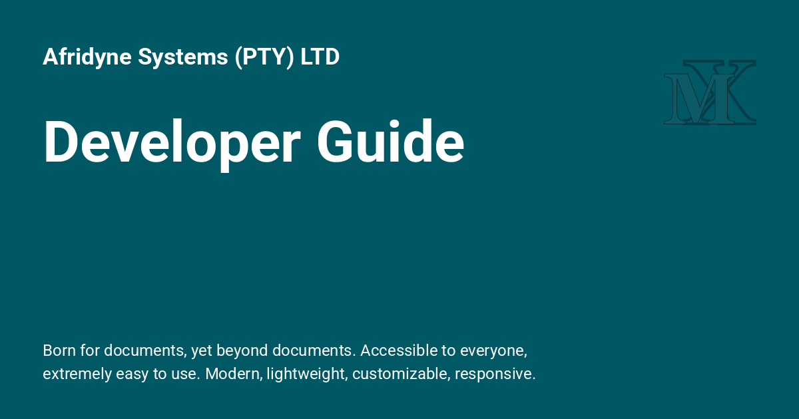

<h1>Developer Guide</h1>

{: style="display: block; margin: 0 auto"}

# Developer Guide { .centered }

## Extending ProperDocs { .centered }

---

!!! abstract "Extending ProperDocs"
    The ProperDocs Developer Guide provides documentation for developers of third party themes and plugins. Please see the [Contributing Guide] for information on contributing to ProperDocs itself.
    
    You can jump directly to a page listed below, or use the *next* and *previous* buttons in the navigation bar at the top of the page to move through the documentation in order.
    
    [Contributing Guide]: ../about/contributing.md

    

    -   :material-download: **Themes** [:octicons-arrow-right-24: View Guide](themes.md){ .md-button style="border-color: #2094f3; color: #2094f3" }
        
        A guide to creating and distributing custom themes.

    -   :material-card-text: **Translations** [:octicons-arrow-right-24: View Guide](translations.md){ .md-button style="border-color: #2094f3; color: #2094f3" }
        
        Theme localization guide. Built-in themes included, provide support for translations.

    -   :material-comment-text-outline: **ProperDocs Plugins** [:octicons-arrow-right-24: View Guide](plugins.md){ .md-button style="border-color: #2094f3; color: #2094f3" }
        
        A Guide to installing, using and creating ProperDocs Plugins.

    -   :material-map-legend: **API reference** [:octicons-arrow-right-24: View Layout](api.md){ .md-button style="border-color: #4caf50; color: #4caf50" }
        
        Main entry point to API through [Events](plugins.md#events), received by plugins.

    
