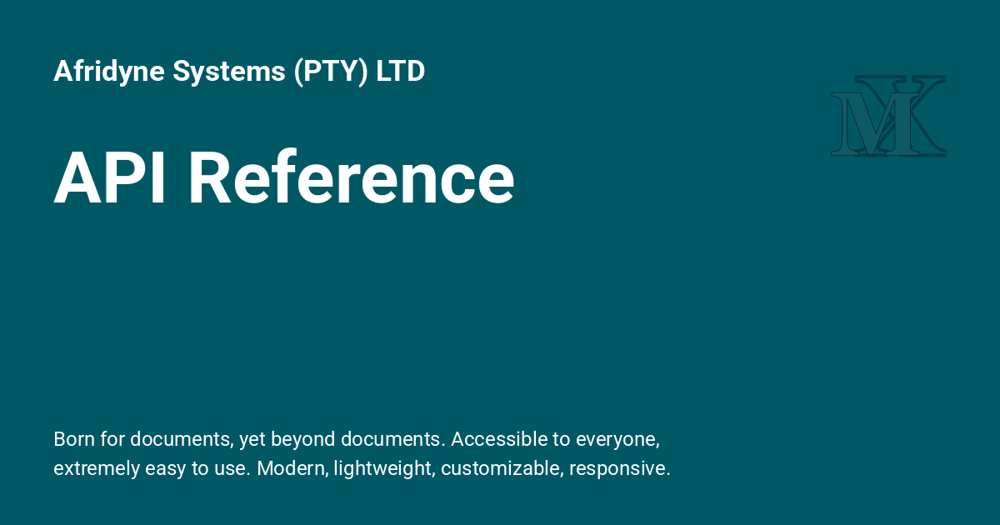

<h1>API reference</h1>

{: style="display: block; margin: 0 auto"}

# API reference { .centered }

!!! decision "Main Entry point to API"

    The main entry point to the API is through [Events](plugins.md#events) that are received by plugins. These events' descriptions link back to this page.
    
!!! recommendation ""

    ::: properdocs.structure.files.Files
        options:
          show_root_heading: true
    
!!! desc ""

    ::: properdocs.structure.files.File
        options:
          show_root_heading: true
          
!!! recommendation ""

    ::: properdocs.config.base.Config
        options:
          show_root_heading: true

!!! desc ""

    ::: properdocs.utils.templates.TemplateContext
        options:
          show_root_heading: true
          show_if_no_docstring: true
    
!!! recommendation ""

    ::: properdocs.livereload.LiveReloadServer
        options:
          show_root_heading: true
    
