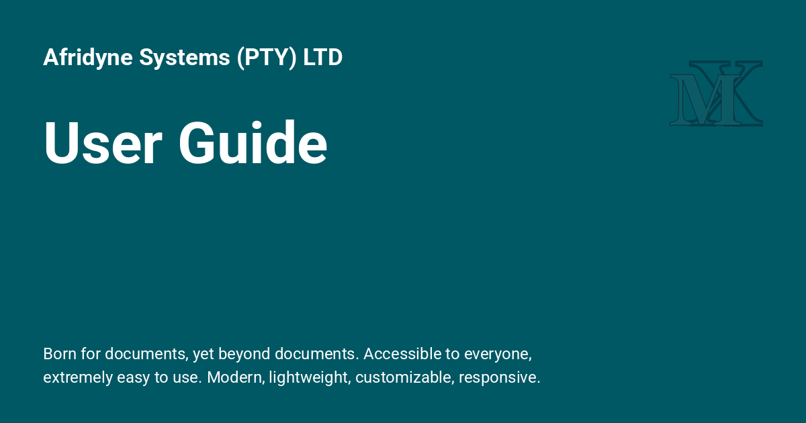

<h1>User Guide</h1>

{: style="display: block; margin: 0 auto"}

# User Guide { .centered }

## Building Documentation with ProperDocs { .centered }

---

!!! info "ProperDocs User Guide"

    The ProperDocs User Guide provides documentation for users of ProperDocs. See [Getting Started] for an introductory tutorial. You can jump directly to a page listed below, or use the *next* and *previous* buttons in the navigation bar at the top of the page to move through the documentation in order.
    

[Getting Started]: ../getting-started.md

-   :material-download: **Installation**
    [:octicons-arrow-right-24: View Guide](installation.md){ .md-button style="border-color: #2094f3; color: #2094f3" }

    Step-by-step instructions to get ProperDocs up and running.

-   :material-cog: **Writing Your Docs**
    [:octicons-arrow-right-24: View Guide](writing-your-docs.md){ .md-button style="border-color: #2094f3; color: #2094f3" }

    How to layout and write your Markdown source files.

-   :material-rocket-launch: **Choosing Your Theme**
    [:octicons-arrow-right-24: View Guide](choosing-your-theme.md){ .md-button style="border-color: #2094f3; color: #2094f3" }

    Selecting and configuring a theme.

-   :material-map-legend: **Customizing Your Theme**
    [:octicons-arrow-right-24: View Layout](customizing-your-theme.md){ .md-button style="border-color: #4caf50; color: #4caf50" }

    Altering a theme to suit your needs.

-   :material-forum: **Localizing Your Theme**
    [:octicons-arrow-right-24: Preferred Language](localizing-your-theme.md){ .md-button style="border-color: #4caf50; color: #4caf50" }

    Display your theme in your preferred language.

-   :material-alert-circle: **Configuration**
    [:octicons-arrow-right-24: View Guide](configuration.md){ .md-button style="border-color: #4caf50; color: #4caf50" }

    Guide to all available configuration settings.

-   :material-card-text: **Cmd Line Interface**
    [:octicons-arrow-right-24: View Settings](cli.md){ .md-button style="border-color: #ff9800; color: #ff9800" }

    ProperDocs - Project documentation with Markdown.

-   :material-brush: **Deploying Docs**
    [:octicons-arrow-right-24: Deploying](deploying-your-docs.md){ .md-button style="border-color: #ff9800; color: #ff9800" }

    Basic guide to deploying docs to various hosting providers

-   :material-book-open-variant: **Getting Started**
    [:octicons-arrow-right-24: Intro. Tutorial](../getting-started.md){ .md-button style="border-color: #ff9800; color: #ff9800" }

    Install ProperDocs and a basic theme.

