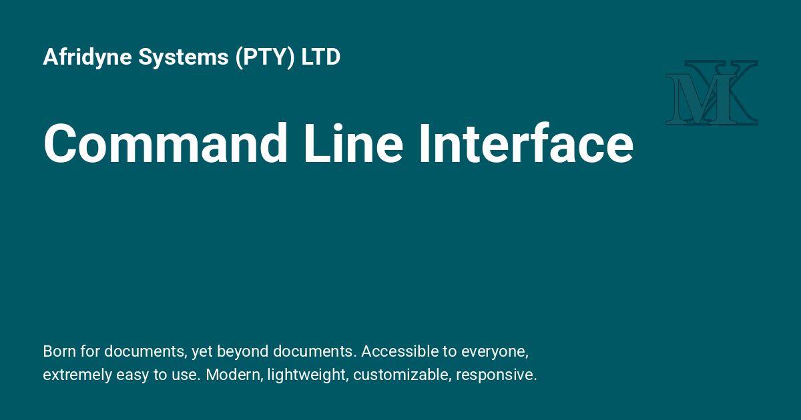

<h1>Command Line Interface</h1>

{: style="display: block; margin: 0 auto"}

<H1 style="text-align: center;">Command Line Interface</H1>

::: mkdocs-click
    :module: properdocs.__main__
    :command: cli
    :prog_name: properdocs
    :style: table
    :list_subcommands: true
