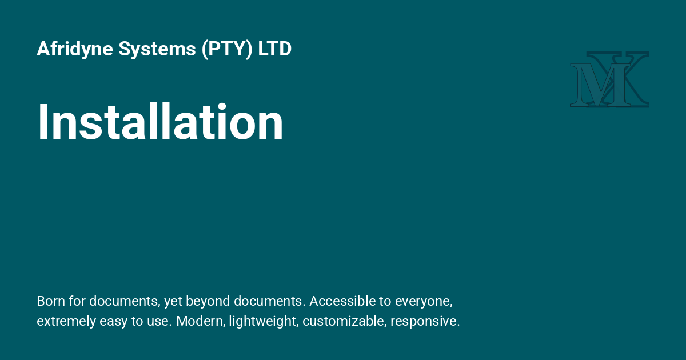
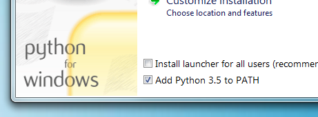

{: style="display: block; margin: 0 auto"}

# ProperDocs Installation  {: .center }

## A detailed guide.  {: .center }

---

## Requirements

!!! recommendation "Requirements"

    ProperDocs requires a recent version of [Python] and the Python package manager, [pip], to be installed on your system.
    
    You can check if you already have these installed from the command line:
    
    ```console
    $ python --version
    Python 3.8.2
    $ pip --version
    pip 20.0.2 from /usr/local/lib/python3.8/site-packages/pip (python 3.8)
    ```
    
    If you already have those packages installed, you may skip down to [Installing ProperDocs](#installing-properdocs).
    
### Installing Python

!!! desc "Installing Python"

    Install [Python] using your package manager of choice, or by downloading an installer appropriate for your system from [python.org] and running it.
    
!!! info "NOTE:"

    If you are installing Python on Windows, be sure to check the box to have Python added to your PATH if the installer offers such an option (it's normally off by default).
    
    
    
### Installing pip or uv

!!! ex "Installing pip or uv"

    If you're using a recent version of Python, the Python package manager, [pip], is most likely installed by default. However, you may need to upgrade pip to the lasted version:
    
    ```bash
    pip install --upgrade pip
    ```
    
    `uv` on macOS and Linux"
    
    ```zsh
    curl -LsSf https://astral.sh/uv/install.sh | sh
    ```
    
    If you need to install pip for the first time, download [get-pip.py]. Then run the following command to install it:
    
    ```bash
    python get-pip.py
    ```
    
## Installing ProperDocs

!!! desc "Installing ProperDocs"

    Install the `properdocs` package using pip:
    
    ```bash
    pip install properdocs
    ```
    
    You should now have the `properdocs` command installed on your system. Run `properdocs --version` to check that everything worked okay.
    
    ```console
    $ properdocs --version
    properdocs, version 1.2.0 from /usr/local/lib/python3.8/site-packages/properdocs (Python 3.8)
    ```
    
    !!! ex "NOTE:"
    
        If you are using Windows, some of the above commands may not work out-of-the-box.
        
        A quick solution may be to preface every Python command with `py -m` like this:
        
        ```bash
        py -m pip install properdocs
        py -m properdocs
        ```
        
        See information about the [Python Launcher for Windows](https://docs.python.org/3/using/windows.html#basic-use).
        
        Or you may need to edit your `PATH` environment variable to include the `Scripts` directory of your Python installation.
        
        Recent versions of Python include a script to do this for you.
    
[Python]: https://www.python.org/
[python.org]: https://www.python.org/downloads/
[pip]: https://pip.readthedocs.io/en/stable/installing/
[get-pip.py]: https://bootstrap.pypa.io/get-pip.py
