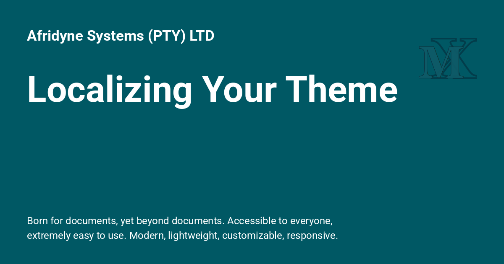

<div style="display: none;"><h1>Localizing Your Theme</h1></div>

{: style="display: block; margin: 0 auto"}

# Localizing Your Theme { .centered }

## Display your theme in your preferred language. { .centered }

---

!!! important "NOTE:"

    Theme localization only translates the text elements of the theme itself (such as "next" and "previous" links), not the actual content of your documentation. If you wish to create multilingual documentation, you need to combine theme localization as described here with a third-party internationalization/localization plugin.
    
## Installation

!!! desc "Installation"

    For theme localization to work, you must use a theme which supports it and enable `i18n` (internationalization) support by installing `properdocs[i18n]`:
    
    ```bash
    uv pip install 'properdocs[i18n]'
    ```
    
## Supported Locales

!!! ex "Supported Locales"

    In most cases a locale is designated by the [ISO-639-1] (2-letter) abbreviation for your language. However, a locale may also include a territory (or region or county) code as well. The language and territory must be separated by an underscore. For example, some possible locales for English might include `en`, `en_AU`, `en_GB`, and `en_US`.
    
    For a list of locales supported by the theme you are using, see that theme's documentation.
    
    - [mkdocs](choosing-your-theme.md#mkdocs-locale)
    - [readthedocs](choosing-your-theme.md#readthedocs-locale)
    
    !!! warning "Warning"
    
        If you configure a language locale which is not yet supported by the theme that you are using, ProperDocs will fall back to the theme's default locale. 
        
## Usage

!!! desc "Usage"

    To specify the locale that ProperDocs should use, set the [locale] parameter of the [theme] configuration option to the appropriate code.
    
    For example, to build the `mkdocs` theme in French you would use the following in your `properdocs.yml` configuration file:
    
    ```yaml
    theme:
      name: mkdocs
      locale: fr
    ```
    
## Contributing Theme Translations

!!! education "Contributing Theme Translations"

    If a theme has not yet been translated into your language, feel free to contribute a translation using the [Translation Guide].
    
[Translation Guide]: ../dev-guide/translations.md
[locale]: configuration.md#locale
[theme]: configuration.md#theme
[ISO-639-1]: https://en.wikipedia.org/wiki/ISO_639-1
